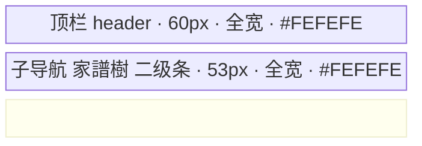
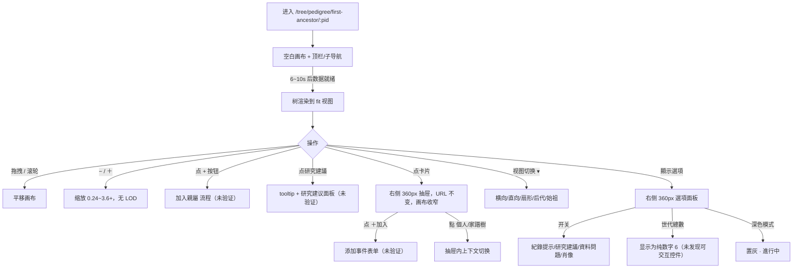

# FamilySearch 世系（谱系树）编辑器 — 可复刻 UI/UE 规格

> **实测对象**：`https://www.familysearch.org/zh-Hant/tree/pedigree/first-ancestor/PJD3-RQ5`
> **实测时间**：2026-11-19（Asia/Shanghai）
> **实测环境**：ego-browser（Chromium，桌面窗口 2294×802 CSS px，DPR 1.5；另做 1440×900 / 768×1024 / 390×844 三档覆写）
> **账号状态**：已登录（页面右上显示用户名「波2」），因此本文覆盖的是**登录后**的完整编辑态
> **证据目录**：`D:\Users\bobo\Documents\Trae-CN\temp_20261119_01\lineage-editor-ui-shots\`（文件名与章节对应关系见第 12 节）
>
> **取证方法**：截图（含 3×/4× 元素级裁切）+ `getComputedStyle` / `getBoundingClientRect` 批量取值 + 交互回放（点击、悬停、Tab、滚轮、拖拽、缩放连点）。
> 下文所有 px / 颜色值 **均为浏览器计算值**，不是目测。凡未取到计算值、仅凭截图目测的，标注「目测」；凡无法观察到的，标注「未验证」。
>
> **第二轮补充（DOM/HTML 优先）**：同一页面重新取证，以 `outerHTML` + DOM 骨架 + landmark/heading/aria 探测为主要依据，补齐 §13–§17。
> 标记规则：§1–§12 为**渲染实测**（计算样式 + 截图）；**§13–§17 为 HTML 结构取证**（DOM 存在性、属性、链接目标、渲染方式），其中与第一轮冲突的结论已在 §13.3 显式修正。

---

## 0. 证据边界（先读这一节，避免照抄不存在的功能）

| 结论类别 | 状态 | 说明 |
|---|---|---|
| 页面骨架、工具栏、卡片、连线、世代标尺 | ✅ 完整实测 | 有计算值与裁切图 |
| 卡片全部状态（默认/路径/首始祖/悬停/焦点/低缩放） | ✅ 实测 | 悬停态变化极弱，见 §4.4 |
| 缩放/平移/视图切换/显示选项/键盘焦点顺序 | ✅ 实测 | 见 §6 |
| 点击人物 → 右侧详情抽屉 | ✅ 实测 | URL 不变，画布宽度 −360px，见 §7 |
| 抽屉内「加入」→「出生」事件表单的**结构** | ✅ 已补齐（HTML） | 第二轮以 DOM 为依据：字段顺序、label、combobox、计数器、`aria-describedby` 全部取到，见 §14 |
| 表单提交后的校验 / 报错 / 成功反馈文案 | ⚠️ 未验证 | 未提交任何数据；HTML 里既无 `required` 也无 `role="alert"`，报错只能运行时产生 |
| 空态（无亲属、新建人物） | ⚠️ 未验证 | 画布空白加载态有截图，业务空态没有 |
| 深色模式 | ⚠️ 明确「進行中」 | 显示选项面板内有 `深色模式（進行中）` 且开关为关、灰态，**视为未上线** |
| 缩放到底是否切换「简化卡片」 | ❌ 未出现 | 最小档（≈24%）卡片仍是同一套 DOM，只是整体缩放，未触发简化变体 |
| 打印 | ❌ 未点击 | 仅有入口按钮 |
| 后代/横向/直向/扇形视图 | ⚠️ 仅入口 | 第二轮从菜单 DOM 取到 5 个视图的**真实 URL**（见 §15），但未逐个进入拍摄 |
| 无障碍语义（landmark / heading / aria / tabindex） | ✅ 已补齐（HTML） | 见 §16，含 6 处可证实的语义缺陷 |

---

## 1. 页面结构分层

### 1.1 横向分层（从外到内）



### 1.2 纵向尺寸带（实测，桌面 2294×802）

| 区域 | y 起点 | 高度 | 备注 |
|---|---|---|---|
| 顶栏 header | 0 | **60px** | `padding: 0 24px`，无底边框、无阴影 |
| 子导航条（家譜樹二级） | 60 | **53px** | 右侧「最新消息」按钮 40×40，居中于该条 |
| 画布 stage | 113 | 689（= 视口高 − 113） | 背景 `#EAECEC`；其外还有一层 `#DCDEDE` 包裹层（视觉上是 1px 深灰描边效果） |
| 右侧面板 / 抽屉 | 113（打开时铺到 0） | 全高 | 宽 **360px**，打开时画布宽度由 2294 → **1934**（挤压，不是浮层覆盖） |

> **关键点**：右侧面板打开会**改变画布可用宽度**（`stage.clientWidth = 窗口宽 − 360`），树会重新 fit。这是复刻时最容易做成浮层遮盖的地方。

### 1.3 桌面骨架线框（1440 视口，见截图 `03-desktop-1440.png`）

```
┌──────────────────────────────────────────────────────────────────────────────┐
│ 🌳 FamilySearch   家譜樹  搜尋  回憶  一起參與  活動        📍 🌐 ? 💬 🔔 (波2)│ 60
├──────────────────────────────────────────────────────────────────────────────┤
│ [家譜樹] 最近檢視的人物  尋找  追蹤中  個人名單  我提供的資料          ✳       │ 53
├──────────────────────────────────────────────────────────────────────────────┤
│                                                    ┌───────────────────────┐ │
│                                    ┌───────────┐   │ 始祖世系圖 ▾ │🖨│⚙│⌂│⤢│− │+│ │
│                                    │ 陈    张  │   └───────────────────────┘ │
│                        陈 氏       │ 元    氏  │            （浮动工具栏，贴画布右上）│
│                                    │ 英        │                             │
│                                    └───────────┘                             │
│                                         │                         ①          │
│                          ┌──────────────┴───────────────┐                    │
│                          ▼              ▼               ▼                    │
│                    ┌───────────┐  ┌───────────┐  ┌───────────┐       ②      │
│                    │ 陈  王  ──│──│   ...     │  │   ...     │               │
│                    └───────────┘  └───────────┘  └───────────┘               │
│                         ▲(折叠圆钮)                                  ③       │
│  ┌──┐                                                                        │
│  │回│ ← 左缘固定「意見回饋」竖排胶囊（16 宽）                                 │
│  │饋│                                                   画布底色 #EAECEC      │
└──────────────────────────────────────────────────────────────────────────────┘
```

> 世代编号 ①②③ 画在**画布右缘**（不是左缘），见 §3.3。

---

## 2. 顶栏 / 子导航 / 浮动工具栏

### 2.1 顶栏（60px）

- 背景 `#FEFEFE`，文字 `#202121`，字号 16px，字体栈 `"HeritageBody:Sans", "HanaMinBFont", ui-sans-serif, system-ui, sans-serif`。
- 左：Logo（约 24px 高）+ 主菜单 5 项（家譜樹 / 搜尋 / 回憶 / 一起參與 / 活動），主菜单 `nav` 高 36px，与 Logo 间距 16px，菜单项之间约 24px。
- 右：6 个 40×40 圆形图标按钮，间距 0（紧邻），依次为 地點 / 選取語言 / 幫助與學習 / 聊天 / 通知 / 账户（头像 + 用户名）。
- 无底部分割线（靠子导航的底色差异区分），**不要加 border-bottom**。

### 2.2 子导航条（53px）

- 文案顺序：`家譜樹`（当前，胶囊高亮）/ `最近檢視的人物`（下拉）/ `尋找` / `追蹤中` / `個人名單` / `我提供的資料`；右端 40×40 图标按钮「最新消息」。
- 当前项高亮：**米黄色胶囊底 + 深色文字**，圆角约 4px，内边距约 6px 10px（目测；未取到该 li 的计算样式，因为它与主菜单同名链接重名）。
- 链接默认色 `#202121`，非当前项无下划线、无底色。

### 2.3 浮动工具栏（画布右上，浮在树之上）

实测按钮序列（左 → 右）：

| # | 控件 | 尺寸 | 说明 |
|---|---|---|---|
| 1 | 视图切换 `始祖世系圖 ▾` | **143×36** | 左图标 + 文本 + 右 chevron，白底圆角 4，打开 148×180 菜单（5 项） |
| 2 | 列印 | 36×36 | 图标 24px |
| 3 | 顯示選項 | 36×36 | 打开右侧 360px 面板 |
| 4 | 重設世系表 | 36×36 | 重置世代/展开状态 |
| 5 | 重設檢視畫面 | 36×36 | 重置缩放与平移（与 4 分离，两个独立按钮） |
| 6 | 縮小 | 36×36 | 与 7 共用一组（`groupCss`，中间 1px 分隔） |
| 7 | 放大 | 36×36 | 组内右侧，圆角 `0 4px 4px 0` |

- 定位：`top: 16px`（画布顶 113 + 16 = 129）、`right: 16px`；按钮水平间距 **4px**（组内 0）。
- 外观：底 `#FEFEFE`，图标 24px，图标色 `rgba(0,3,5,0.737)`，圆角 4px，阴影 = Material Elevation 2：
  `0 1px 5px rgba(0,0,0,.20), 0 2px 2px rgba(0,0,0,.14), 0 3px 1px -2px rgba(0,0,0,.12)`
- 注意：**放大/缩小按钮没有独立阴影**（它们继承分组容器的阴影），单个 36×36 重置类按钮才有。
- 左缘还有一条固定的「意見回饋」竖向胶囊（白底、16px 宽、含关闭 ×），属于全局组件，不是编辑器的一部分。

---

## 3. 画布与世代标尺

### 3.1 画布

- `stage` 背景 **`#EAECEC`**；外层 `wrapper` 背景 **`#DCDEDE`**（只露出 1px，形成画布"内凹"的边界感）。
- 画布内所有内容是**普通 DOM + CSS transform 缩放**，不是 canvas 绘制：因此文字会随缩放真实变小（缩到 24% 时正文只剩约 3px 高，完全不可读），**没有 LOD/简化卡片切换**。

### 3.2 树的布局模型（始祖世系图 / first-ancestor）

- 这是**以「始祖」为根、向下展开后代**的视图，不是传统的向上祖先树。
- 一行 = 一代；每一代由若干「夫妻块（couple）」横排组成；夫妻块之间是并列的子女及其配偶。
- 夫妻块上方居中显示**族姓标签**：文本形如 `陈 氏`（姓 + 空格 + 氏），字号 **35px**、色 `#202121`，容器宽度由 CSS 变量 `--clan-name-width: 275px` 控制（实测渲染宽 220px）。
- 实测几何（100% 缩放、未含首始祖放大）：

| 常量 | 值 | 来源 |
|---|---|---|
| 单张人物卡 | **123 × 220** px（含边框） | tile 计算宽 122.7 / 高 219.8 |
| 卡内边距 | **20px 25px** | `padding: 20px 25px` |
| 夫妻两卡间距 | **16px** | couple 容器 261.3 − 2×122.7 |
| 夫妻块（含溢出按钮） | 261 × 286 | li 实测 |
| 代际垂直步距（行距） | **320px** | 相邻两代 li 的 y 差 |
| 首始祖卡片 | **×1.2 放大**（147×264） | tile `transform: matrix(1.2,0,0,1.2,0,-27.48)` |

> 首始祖卡片放大 20%，并且**向上偏移约 27px**（补偿放大后的视觉重心）。复刻时如果只放大不平移，卡片会显得下沉。

### 3.3 右缘世代标尺

- 位置：画布右缘，`x ≈ 画布宽 − 35`，宽 35px，与每一代的行中心对齐。
- 数字：`1 2 3 …`，字号 **16px**，字重 **600**，色 `#202121`。
- 数字下方有一条 **35×2px** 的细分隔线（`levelCss`，同一代的刻度）。
- 当某代被折叠时，标尺会出现区间表达（例如 `1 2 3 ‑ 7 8 9`，中间用短横表示被折叠的世代段）——**只在折叠状态观察到，未逐一验证折叠交互细节**。

---

## 4. 人物卡片

### 4.1 解剖图（基础 123×220，见截图 `04-crop-person-card.png`）

```
┌──────────────────────────────────┐ ← 圆角 8px，外阴影 0 1px 3px rgba(0,0,0,.2)
│▬▬▬▬▬▬▬▬▬▬▬▬▬▬▬▬▬▬▬▬▬▬▬▬▬▬▬▬▬▬▬▬▬│ ← 顶部 4px 性别色条（男 #2097B7 / 女 #ED5481）
│ ⬤★                        ＋     │ ← 左上：首始祖徽标（仅首始祖，22.5px 琥珀圆）
│                                   │   右上：＋「加入親屬」（24px 图标，命中区 35~42px）
│            陈                     │
│            元                     │ ← 中文姓名：20px / 400 / vertical-rl（竖排）
│            英                     │
│                                   │
│                                   │
│          Chen Yuanying            │ ← 拉丁名（链接，悬停加下划线）12.3px
│              歿                   │ ← 生卒：12.3px
│           PJD3‑RSR                │ ← PID 胶囊 12.3px，圆角 50px，命中即复制
│                                   │
│               ◉                   │ ← 底部居中：研究建議徽标（19px 紫圆）
└──────────────────────────────────┘
```

### 4.2 字段与元素清单

| 元素 | 内容 | 版式 / 尺寸 | 交互 | 备注 |
|---|---|---|---|---|
| 顶部色条 | 无文字 | 边框 `border-top: 4px`，男 `#2097B7`，女 `#ED5481` | 无 | **性别只用颜色编码**；文字「男/女」是 1×1px 的屏幕阅读器文本 |
| 中文姓名 | 全名（姓+名） | 20px / 400 / `writing-mode: vertical-rl`，居中 | 点击卡片任意非按钮区域 | 仅对含 CJK 的姓名启用竖排（class `cjkMonogram`，`lang=zh`）；纯拉丁名排版**未验证** |
| 拉丁名 | `Chen Yuanying` | 12.3px，色 `rgba(0,3,5,0.737)`，居中 | `<a href="/tree/person/{PID}">`，悬停出现下划线 | 真正的"跳转人物页"入口 |
| 生卒 | `歿` / `1752年–歿` / `1909年–1985年` / `存` | 12.3px，同上色，居中，单行省略 | 无 | 有生年才显示年份；在世显示「存」 |
| PID | `PJD3-RSR` | 胶囊：12.3px，`padding 2px 8px 3px`，`border-radius 50px`，透明底、灰边/灰字 | 点击复制，`aria-label="P J D 3 R S R, 選取以複製。"` | 无障碍标签是**逐字符拆读**的写法 |
| ＋ 加入亲属 | — | 图标 24px，命中区 35×35（放大态 42×42），圆角 500px | 悬停底色 `rgba(0,157,209,0.15)`；`aria-label="為{姓名}加入親屬"` | 常驻可见，不是悬停才出现 |
| 首始祖徽标 | 人形 + 星 | 圆形，直径 22.5px（放大态 27px），底 `#FFC400`，图标深色 | 无（纯标识） | 只有 `first-ancestor` 卡片有 |
| 研究建議徽标 | 竖排纹样图标 | 圆 19px（放大态 23px），底 `#785B93`，悬停 `#8E69B0` + 2px 同色外环 | 点击打开研究建议；tooltip「檢視研究建議」 | 这个紫色是 FS 的"研究/提示"语义色 |
| 整卡命中区 | — | 卡片全部（不含上述按钮自身区域） | `role="group" tabindex="0" aria-haspopup="true"`，`title` 为「姓名\n生卒 · PID」原生 tooltip | 键盘可达，见 §6.5 |

> **卡片里没有的东西**（别自己脑补）：没有头像照片位（头像只在右侧面板出现）、没有地点字段、没有事件摘要、没有"更多 ⋯"菜单、没有选中态描边。

### 4.3 「路径」与「首始祖」是两套不同编码

实测 tile 上的属性直接暴露了状态机：`sex` / `path=""` / `first-ancestor=""`。

| 状态 | 卡片底色 | 边框 | 附加 | 语义 |
|---|---|---|---|---|
| 普通男 | `#FEFEFE` | 仅上边 4px `#2097B7` | — | — |
| 普通女 | `#FEFEFE` | 仅上边 4px `#ED5481` | — | — |
| **直系（path）男** | **`#FAF7DB`**（米黄） | 上 6px 性别色 + 其余三边 4px **`#FFC400`**（琥珀） | — | 从始祖到「焦点个人」的直系链 |
| **首始祖** | `#FAF7DB` | 同 path + **×1.2 放大** | 左上琥珀圆形徽标 | 树根 |
| 悬停 | 不变 | 不变 | 拉丁名出现下划线（仅指针移到链接上时） | **卡片本身没有 hover 视觉反馈**（实测 bg/shadow 均无变化） |
| 键盘焦点 | 不变 | 不变 | 2.67px 实线 outline，色 `#0383A4`（卡片）/ `#8E69B0`（研究建议）/ `rgba(0,9,13,.467)`（PID） | outline 用 `outline-*`，不是 box-shadow |
| 禁用 | — | — | 未观察到任何禁用态卡片 | — |
| 加载 | — | — | 卡片为**整块后出现**，没有单独的卡片骨架屏（首屏是整张空白画布，见 `01-landing.png`） | — |

### 4.4 卡片状态矩阵（复刻用）

| 状态 | 背景 | 边框 | 阴影 | 文字 | 图标 | 光标 |
|---|---|---|---|---|---|---|
| 默认-男 | `#FEFEFE` | top 4px `#2097B7` | `0 1px 3px rgba(0,0,0,.2)` | `#202121` / 次 `rgba(0,3,5,.737)` | 24px `rgba(0,3,5,.737)` | card: default；链接: pointer |
| 默认-女 | `#FEFEFE` | top 4px `#ED5481` | 同上 | 同上 | 同上 | 同上 |
| 直系 | `#FAF7DB` | top 6px 性别色 + 3 边 4px `#FFC400` | 同上 | 同上 | 同上 | 同上 |
| 悬停（卡片） | 不变 | 不变 | 不变 | 不变 | 不变 | default |
| 悬停（拉丁名） | — | — | — | 下划线 `text-decoration: underline` | — | pointer |
| 悬停（＋） | `rgba(0,157,209,.15)` 圆形 | 无 | 无 | — | `#057091` | pointer |
| 悬停/聚焦（研究建議） | `#8E69B0` + 外环 | ring 2px `#8E69B0` | 保留 | — | 白色图标 | pointer |
| 键盘聚焦（整卡） | 不变 | 不变 | 不变 | 不变 | 不变 | — |
| 低缩放（≤ 40%） | 全部样式保留 | 保留 | 保留 | 字号不降，整体被 transform 缩小 | 同 | — |

---

## 5. 连线与亲属关系表达

### 5.1 几何

- 正交折线（manhattan），**圆角为 0**（直角），所有线段共用一个覆盖整棵树的绝对定位 SVG 层（实测某条水平总线 SVG 宽 1632px，path 坐标是树坐标系绝对值）。
- 夫妻：两卡**底边各向下 32px** 有一条短竖线，然后横向连成一条水平线，再从水平线中点向下引出主干。
- 亲子：主干向下 → 水平分叉总线 → 每个子女块一条短竖线接入卡片顶部。

### 5.2 线样式（实测 `stroke-width` 与 `stroke`）

| 关系 | 颜色 | 线宽 |
|---|---|---|
| 普通亲属连线 | **`#9EA1A3`** | **2px** |
| 直系（path）连线 | **`#333435`** | **3px** |
| 配偶短竖线（非直系一侧） | `#9EA1A3` | 2px |

> 直系链的线**又深又粗**（#333435 / 3px），非直系是浅灰细线（#9EA1A3 / 2px）。这是"一眼看出直系"的主要手段，比卡片底色更抢眼。**如果你只做了卡片米黄底而连线是统一灰色，视觉上会明显不像。**

### 5.3 折叠按钮

- 位置：主干与子女总线交汇处（子女分叉的中点）。
- 外观：直径 **32px** 的圆，底 `#F5F6F6`，白描边/白晕（约 2px 白环把它和线条隔开），chevron 图标 19px、色 `#057091`。
- 方向：展开态朝上（`∧`），折叠态朝下（`∨`）。`icon-direction="up"` 是 DOM 上的显式标记。
- 无 `aria-label`（实测该按钮/div 没有可访问名，只有 div + class `expandUpCss`）——**这是原站的可访问性缺陷，复刻时建议补 `aria-expanded`**。

---

## 6. 交互规格

### 6.1 缩放

- 入口只有工具栏 `−` / `+` 两个按钮（**滚轮不缩放**，见 6.2）。
- 步进约 **×1.28**（连点实测序列换算：0.238 → 0.31 → 0.40 → 0.65 → 0.85 → 1.19 → 1.71 → 2.04 → 2.76 → 3.61）。
- **下限 ≈ 0.24**（再点无变化），**上限 ≥ 3.61**（未测到硬上限，按钮始终不置灰）。
- 缩小时**不切换简化卡片**：DOM 不变，子元素字号不变（仍是 12.3px），只是整树 transform 缩放，文字随之缩小到不可读。
- `重設檢視畫面` 把缩放/平移复位；`重設世系表` 复位世代展开状态。两者不要合并。

### 6.2 平移

- **鼠标拖拽**画布：按下拖动，内容跟手（实测位移 −140, −50 时卡片同步移动 −140, −50）。
- **滚轮**在画布上：纵向平移（卡片 y 从 106 → 442，尺寸不变）。**不是缩放**，这与 Figma 类工具体验相反，做同类产品时要明确取舍。
- 画布不产生页面级滚动条（窄屏下 `document.body.scrollWidth == 视口宽`），超出部分靠拖拽。

### 6.3 点击节点

- 点击卡片（非链接/非按钮）→ 右侧滑出 **360px 人物抽屉**，**URL 不变**，画布宽度收缩 360px。
- 抽屉不是遮罩浮层：没有半透明遮罩、没有焦点陷阱的视觉证据；按 `Esc` **不会关闭**（实测无效）。
- 打开后工具栏与树一起被挤压（右侧 360px 让出）。

### 6.4 视图切换菜单

点击 `始祖世系圖 ▾` → 弹出 148×180 白底菜单（圆角约 8px，阴影同浮层），5 项：

| 项 | 图标 | 说明 |
|---|---|---|
| 橫向 | 横向树 | 传统左右向祖先树 |
| 直向 | 纵向树 | 上下向 |
| 扇形圖 | 扇形 | fan chart |
| 後代 | 后代图 | descendancy |
| **始祖世系圖**（当前） | 始祖树 | **当前项：整行灰底 `≈#E4E4E4`、满宽高亮** |

- 行高约 36px，图标 24px 线性风格，图标与文字间距约 16px。
- 当前项用**满宽灰色底**表达选中，不用勾选图标。

### 6.5 键盘与焦点顺序

实测 Tab 序列（从画布进入后）：

```
人物卡容器(role=group) → 拉丁名链接 → PID 胶囊按钮 → ＋加入親屬 → 研究建議 → 下一张卡…
```

- 卡片容器 `tabindex="0"`，可整卡聚焦；聚焦后 `Enter/Space` 触发与点击相同的抽屉。
- 焦点环：`outline: 2.67px auto/solid`（等效 2px），颜色随控件主题 —— 卡片 `#0383A4`、研究建议 `#8E69B0`、PID `rgba(0,9,13,.467)`。**不要统一用一种蓝色焦点环**。
- 卡片必须 `aria-haspopup="true"`；`title` 提供原生悬浮提示（姓名 + 生卒 + PID）。

---

## 7. 右侧人物抽屉（详情 + 编辑入口）

见截图 `10-person-drawer.png` / `11-crop-drawer-header.png`。

### 7.1 结构

```
┌──────────────────────────────── 360px ────────────────────────────────┐
│▬▬▬▬▬▬▬▬▬▬▬▬▬▬▬▬▬▬▬▬ 8px 性别色条（男 #2097B7）▬▬▬▬▬▬▬▬▬▬▬▬▬▬▬▬▬▬│
│  ⬤48   陈元英                                             ✕          │
│        PJD3-RSR                                                     │
│                                                                     │
│  品質分數： [目前無法取得]                                           │
│  來源 (0)   回憶 (0)   互助合作 (0)          ← 三个下划线链接          │
│  出生:                                                              │
│  死亡: 歿                                                           │
│  ☆   ⛓                                        ← 追蹤 / 檢視關係 图标按钮  │
│  ────────────────────────────────────────────                        │
│  [  👤 個人  ]      [  🌳 家譜樹  ]           ← 两枚描边**跳转链接**（非切换）│
│                                                                     │
│  重要資料                         20.8px                             │
│  出生                                                               │
│  ＋ 加入                         ← 12.3px 蓝绿链接                   │
│  領洗                                                               │
│  ＋ 加入                                                            │
│  死亡 • 0 項來源 歿                                                 │
│  ＋ 加入                                                            │
│  埋葬                                                               │
│  ＋ 加入                                                            │
│                                                                     │
│  事項 (0)                        ＋ 加入事項                        │
│  基本資料 (0)                    ＋ 加入基本資料                     │
│  簡史                            ＋ 加入簡史                         │
└─────────────────────────────────────────────────────────────────────┘
```

### 7.2 关键样式

| 元素 | 规格 |
|---|---|
| 顶部色条 | 高约 8px（目测），性别色，与卡片一致 |
| 头像 | 48px 圆；`avatarCss` > `avatarCircleCss` > `monogramCss`，内容为**姓名首字**（实测为「陈」），浅蓝底 + 深蓝字。**不是照片占位、也不是剪影** |
| 姓名 | 16px / 600 / `#202121` |
| PID | 约 13px，灰 `rgba(0,0,0,.6)` |
| 关闭 | 40×40 图标按钮，`aria-label="關閉"` |
| 质量分胶囊 | 灰底 `≈#EFEFEF`，圆角 4px，内边距 4px 8px，13px |
| 统计链接 | `#057091`，**带下划线**，13px；数字在括号内 |
| 字段标签 `出生:` / `死亡:` | 16px / 600 |
| 分区标题 `重要資料` / `事項 (0)` | **20.8px / 400**（heading 字体，不是 bold） |
| 「＋ 加入」 | 12.3px，`#057091`，前面一个 16px `+` 图标，行高 28px，圆角 4px |
| 描边链接（個人 / 家譜樹） | 高 44px，1px `#057091` 描边，圆角 6px，文字 16px；DOM 为 `<a href>`，**没有** `aria-current`/`aria-selected`，视觉"选中"纯 CSS |
| 分区之间 | 1px 分隔线，左右各留 16px |

### 7.3 编辑链路（实测到哪一步）

1. 树 → 点卡片 → 抽屉（URL 不变）。
2. 抽屉里的每个事件分组都有 `＋ 加入` → 打开**居中模态框**（不是抽屉内联展开），URL 仍不变。
3. 「個人 / 家譜樹」是两枚 `<a>`：分别跳 `/tree/person/{PID}` 与 `/tree/pedigree/{PID}`，即**离开抽屉的导航**，不是抽屉内切换。抽屉头部还保留一个空的 `div.tabsCss_t1uw3wup`（本视图未渲染任何 tab）。
4. 模态框里 `取消` 关闭、`儲存` 提交（初始 `aria-disabled="true"`）。**未提交任何数据，所以成功/失败后的表现仍未验证。**

> 第二轮已用 DOM 补齐到"表单结构"这一层（§14）；仍**未验证**的是：提交后的校验提示文案、后端错误、并发冲突提示、保存中的 loading。

---

## 8. 视觉 token 表

### 8.1 颜色

| Token | 值 | 用途 |
|---|---|---|
| `--surface-page` | `#FEFEFE` | 顶栏、子导航、卡片底、面板底 |
| `--surface-stage` | `#EAECEC` | 画布底色 |
| `--surface-stage-edge` | `#DCDEDE` | 画布外 1px 内凹边 |
| `--surface-path` | `#FAF7DB` | 直系卡片米黄底 |
| `--text-primary` | `#202121` | 正文、姓名、世代数字 |
| `--text-secondary` | `rgba(0,3,5,0.737)` | 拉丁名、生卒、PID、图标 |
| `--accent-link` | `#057091` | 链接、＋、折叠 chevron、抽屉描边按钮 |
| `--accent-interactive` | `#0383A4` | 焦点环、开关开启态 |
| `--sex-male` | `#2097B7` | 男性顶部色条、抽屉色条 |
| `--sex-female` | `#ED5481` | 女性顶部色条、抽屉色条 |
| `--path-border` | `#FFC400` | 直系卡片三边描边、首始祖徽标底 |
| `--hint-purple` | `#785B93` / hover `#8E69B0` | 研究建議徽标 |
| `--line-default` | `#9EA1A3` | 普通连线 2px |
| `--line-path` | `#333435` | 直系连线 3px |
| `--overlay-bg` | `#100F0E` / 文字 `#FDFCFC` | tooltip |
| `--divider` | `≈#E4E4E4`（目测） | 面板内 1px 分隔线、菜单选中行灰底 |
| `--neutral-bg` | `#F5F6F6` | 折叠圆钮底、头像占位底 |

### 8.2 字号（1.3 模数，实测 CSS 变量 `--text-scale-factor: 1.3`）

| 级别 | 值 | 用途 |
|---|---|---|
| a | **12.3px**（`1rem/1.3`） | 拉丁名、生卒、PID、＋加入、次要说明 |
| b | **16px** | 正文、导航、世代数字、卡片标签、抽屉标题 |
| c | **20.8px** | 分区标题（重要資料/事項/顯示選項 各分区） |
| d | 27px | 未在本次页面出现 |
| e | **35px**（35.15） | 族姓标签 `陈 氏` |
| 卡片姓名 | **20px** / 400 / vertical-rl | 独立于模数，写死在卡片里 |

- 字重几乎全部 **400**；仅注意点标题与世代数字用 **600**。
- 字体栈：`"HeritageBody:Sans"`（正文）/ `"HeritageHeadings:Sans"`（标题）+ **`"HanaMinBFont"` 作为 CJK 回退**。复刻时换成 `Inter + Noto Sans SC` 即可，但**必须保留 CJK 回退位**，否则中文会掉到系统默认衬线。

### 8.3 间距（4px 基准）

| 值 | 用途 |
|---|---|
| 4px | 工具栏按钮间距 |
| 8px | tooltip 内边距、统计链接间距基准 |
| 16px | 顶栏左右内边距、工具栏与画布边距、夫妻卡片间距、面板左右内边距、图标与文字间距 |
| 20 / 25px | 卡片上内边距 / 左右内边距 |
| 32px | 折叠圆钮直径、连线出入段长度 |
| 64px | 显示选项开关行高 |
| 320px | 代际行距 |

### 8.4 圆角

| 元素 | 值 |
|---|---|
| 卡片 | **8px** |
| 工具栏按钮 / 视图切换 | **4px** |
| 面板切换按钮 | 6px（目测） |
| PID 胶囊 / 圆形图标按钮 | 50px / 500px（全圆） |
| 菜单、抽屉 | 8px（仅外角，抽屉贴边侧为 0） |

### 8.5 阴影

| 场景 | 值 |
|---|---|
| 卡片 | `0 1px 3px rgba(0,0,0,.20)` |
| 工具栏单按钮 / 菜单 | `0 1px 5px rgba(0,0,0,.20), 0 2px 2px rgba(0,0,0,.14), 0 3px 1px -2px rgba(0,0,0,.12)` |
| 研究建議徽标 | `0 1px 3px rgba(0,0,0,.20), 0 2px 4px -1px rgba(0,0,0,.14)` |
| 抽屉/面板 | **无阴影**（靠 1px 分隔线与换底色区分） |

### 8.6 动效（部分为观察，非精确值）

- 面板/抽屉：滑动进出（`transition: all`，实测元素上存在 transition），约 200–300ms。
- 缩放：按钮点击后是**平滑过渡**而非瞬时跳变（连点时测量到中间态，说明有动画）。
- tooltip：约 300ms 延迟出现，无淡入淡出观察到。

---

## 9. 关键交互流程



---

## 10. 响应式降级

| 视口 | 实测表现 |
|---|---|
| **1440×900** | 完整布局；树 fit 到画布，卡片约 123px 宽 |
| **768×1024** | 主菜单、子导航、工具栏**全部保持桌面形态**；画布变窄，右侧卡片被画布边缘裁切（不是重排）；工具栏仍单行贴在画布右上 |
| **390×844** | ① 顶栏主菜单 → **汉堡菜单**，只留 Logo + 5 个图标；② 子导航 → `家譜樹 / 最近檢視的人物 / 尋找 / 更多 ▾`；③ 工具栏 → **可横向滚动的一行**（缩放组被挤出首屏，需横滑）；④ 画布仍是同一套可拖拽树，**卡片尺寸不变**（不缩小、不转列表）；⑤ 页面本身不出现横向滚动条（`body.scrollWidth === 390`） |

> 结论：**没有"窄屏切列表/减少世代"的降级**。核心策略是「画布不变、外围导航折叠、工具栏横滚」。如果你们要做移动端，这块等于空白设计，需要自己定义。

---

## 11. 复刻时最容易做错的 10 件事

1. **把右侧面板做成浮层遮罩**。原站是**挤压布局**：打开面板后画布宽度 = 窗口 − 360，树重新 fit。做成 overlay 会导致卡片被遮住、fit 计算错误。
2. **只给直系卡片加米黄底，却把连线画成统一灰色**。直系的辨识度主要来自 **3px `#333435` 深色连线**，浅色 2px `#9EA1A3` 是非直系。
3. **性别用文字标签**。原站性别是 **4px 顶部色条**（男 `#2097B7` / 女 `#ED5481`），文字只存在于屏幕阅读器（1×1px）。加了"男/女"小字就不像了。
4. **低估「首始祖」的三重强调**：米黄底 + 琥珀三边框 + **×1.2 放大并上移 27px** + 左上琥珀圆形徽标。少任何一层都会"看起来对但说不出哪里不对"。
5. **滚轮当缩放用**。原站滚轮是**纵向平移**，缩放只能按 `−/＋`；且缩放**没有 LOD**，不会在低倍时换成精简卡片。
6. **给卡片加 hover 抬升/描边**。实测悬停时卡片 bg、shadow、边框**完全不变**，唯一的反馈是拉丁名链接出现下划线。加浮起效果会显得"过于现代"。
7. **把中文姓名横排**。CJK 姓名是 `writing-mode: vertical-rl` 的竖排（20px），卡片因此是"竖长条"比例 123×220；横排会让整棵树的比例崩塌。
8. **统一焦点环颜色**。焦点环跟随控件主题色（蓝绿 / 紫 / 灰），宽度约 2px；统一成一种蓝会破坏"研究建議"的紫色语义。
9. **忘记卡片内的"四个独立可点区域"**：整卡（抽屉）、拉丁名（跳人物页）、PID（复制）、＋（加亲属）、研究建議徽标（研究面板）。点击区域嵌套，必须做事件隔离，否则点 PID 也会弹抽屉。
10. **把 0.667px / 2.667px 这类值直接抄进设计稿**。它们是页面 `zoom/DPR` 折算后的计算值（等效 0.5px 边框、2px 焦点环）。设计稿里请按 **1px 边框 / 2px 焦点环** 还原。

> 附加两条"看不见但会翻车"的：
> - 字体栈缺少 CJK 回退（`HanaMinBFont` 位）→ 中文掉成衬线体；
> - 世代标尺在**右缘**且带 35×2 的刻度线，容易被误做到左缘。

---

## 12. 截图索引（证据 ↔ 结论）

目录：`D:\Users\bobo\Documents\Trae-CN\temp_20261119_01\lineage-editor-ui-shots\`

| 文件 | 内容 | 支撑章节 |
|---|---|---|
| `01-landing.png` | 首次进入时的空白灰画布（加载中，无骨架屏） | §0、§4.3 加载态 |
| `02-loaded.png` | 树渲染完成（2294 宽窗口，首屏 fit） | §3.2 |
| `03-desktop-1440.png` | 1440×900 桌面全貌：两条导航带 + 浮动工具栏 + 世代标尺 + 树 | §1.3、§2.3 |
| `04-crop-person-card.png` | 3× 卡片裁切：琥珀边框、竖排姓名、PID 胶囊、研究建議徽标 | §4.1、§4.2 |
| `05-crop-couple.png` | 夫妻块整体（族姓标签 + 两卡 + 连接段） | §3.2、§4.2 |
| `07-hover-card.png` | 悬停态：卡片无变化，仅拉丁名加下划线 | §4.4 |
| `08-hover-badge-tooltip.png` | 「檢視研究建議」tooltip（深色 #100F0E、圆角 4） | §4.2、§8.1 |
| `09-after-card-click.png` | 点击卡片后的抽屉态（画布被挤压） | §6.3 |
| `10-person-drawer.png` | 360px 人物抽屉全貌 | §7.1 |
| `11-crop-drawer-header.png` | 抽屉头部 2× 裁切：性别色条、头像占位、质量分胶囊、切换按钮 | §7.2 |
| `14-crop-display-panel-top.png` | 顯示選項面板上部：始祖 / 世代總數 / 焦點個人 | §6.4（面板结构） |
| `15-crop-display-panel-bottom.png` | 顯示選項面板下部：4 个开关 + 深色模式（進行中） | §0、§6.4 |
| `16-display-panel-full.png` | 顯示選項面板与画布并存的整体关系 | §1.2 |
| `17-view-switcher.png` / `18-crop-view-switcher.png` | 视图切换 5 项 + 当前项灰底高亮 | §6.4 |
| `19-zoomout-5.png` | 缩小到约 40% 时的整树（文字仍存在，无简化卡片） | §6.1 |
| `21-zoom-max.png` | 放大到约 360% 时的局部（卡片结构不变） | §6.1 |
| `27-hover-add-relative.png` | 「＋加入親屬」悬停底 `rgba(0,157,209,.15)` | §4.4 |
| `28-crop-couple-connector.png` | 3× 连线裁切：深/浅两种线 + 32px 折叠圆钮 + 徽标外环 | §5.1–5.3 |
| `29-mobile-390.png` | 390 窄屏：汉堡菜单、子导航收敛、工具栏横滚 | §10 |
| `30-tablet-768.png` | 768 平板：布局不重排，画布裁切 | §10 |
| `25-restored.png` / `26-after-wheel.png` | 滚轮 = 纵向平移（卡片 y 位移，尺寸不变） | §6.2 |
| `31-drawer-dom.png` | 第二轮：抽屉 DOM 抓取时的页面状态（用于核对 §13 的结构描述） | §13 |
| `32-add-birth-form.png` | 点「加入 出生」后弹出的模态框（首帧） | §14 |
| `33-birth-form-full.png` | 出生模态框全貌：标题/副标题/三字段/计数器/取消·儲存 | §14 |
| `34-view-switcher-dom.png` | 视图切换菜单（DOM 抓取同帧），5 项均为链接 | §15 |

---

## 13. 人物面板内部结构（取自 HTML 结构，非渲染推断）

> 本节内容来自抓取的 `aside` 完整 `outerHTML`（21 KB）与 DOM 骨架遍历，截图仅作佐证。凡「HTML 未出现」的，就是真的没有，不要再按截图猜。

### 13.1 顶层 shell

```html
<aside class="animatedCss_aoa7mz1" aria-label="" data-testid="personSheet">
  <div class="sliderCss_soec0iq elevationBaseCss_e1vn31hu">
    <div class="fullHeightCss_fcsy4nu">
      <div class="mainWrapperCss_mer28f7">

        <!-- ① 头部：可编程聚焦（tabindex=-1），theme = blueTheme -->
        <header class="infoSheetHeaderCss_ihf097u blueTheme_b1udqlrf headerColorCss_h1wtnbvy bleedableCss_b1qzhorg" tabindex="-1">
          <div class="rowCss_r192m5gk titleCss_t13bh7ec">
            <div class="cellCss_ch6lxlx">
              <div class="avatarCss_a9t6mc5">
                <div class="avatarCircleCss_adoe5fw">
                  <div class="monogramCss_ml2q8t5">陈</div>
                </div>
              </div>
            </div>
            <div class="cellCss_ch6lxlx">
              <h2 class="…headingBaseCss_h1gs3yn9 textBcss_tmy0quz boldCss_b1f5sibe" tabindex="-1">
                <span class="ellipsisCss_e139x152">陈元英</span>
              </h2>
              <p class="textAcss_t13aldzm subheadingBaseCss_s12sc8sa">
                <span class="ellipsisCss_e139x152">PJD3-RSR</span>
              </p>
            </div>
          </div>
          <div class="rowCss_r192m5gk controlsCss_c1n2bd6f">
            <div class="cellCss_ch6lxlx">
              <button class="…iconButtonCss_i1memprp tuckInIconCss_t9tc222 grayLowCss_g1ad3x30"
                      aria-label="關閉" type="button">…</button>
            </div>
          </div>
          <div class="tabsCss_t1uw3wup"></div>   <!-- 空容器：本视图未渲染任何 tab -->
        </header>

        <!-- ② 内容：可聚焦滚动容器 -->
        <div class="contentWrapper_cfjslsq">
          <div class="containerCss_cereag6" role="group" tabindex="0">
            <div class="contentCss_czb43rf"><div class="bleedableCss_b1qzhorg">

              <span>更多關於陈元英的資料。</span>                 <!-- aria-live=assertive 播报 -->
              <div class="separatorCss_s1wrc5wj"></div>

              <div data-testid="quality-score-chip-loaded">
                <p>品質分數：</p>
                <span class="tagCss_t1ade2nw boldCss… grayTheme_gucfp3a">目前無法取得</span>
              </div>
              <div class="separatorCss_s1wrc5wj"></div>

              <div class="rowCss…">
                <a href="/zh-Hant/tree/person/sources/PJD3-RSR"     data-testid="sources-count">來源（0）</a>
                <a href="/zh-Hant/tree/person/memories/PJD3-RSR"    data-testid="memories-count">回憶（0）</a>
                <a href="/zh-Hant/tree/person/collaborate/PJD3-RSR" data-testid="collaborate-count">互助合作（0）</a>
              </div>

              <div data-testid="conclusionDisplay:BIRTH">
                <strong>出生:</strong><span data-testid="conclusion-body"></span>
              </div>
              <div data-testid="conclusionDisplay:DEATH">
                <strong>死亡:</strong>
                <span data-testid="conclusion-body"><span data-testid="conclusion-living-status">歿</span></span>
              </div>

              <div data-testid="temple-status-block"></div>      <!-- 空：本人物无圣殿状态 -->

              <div class="rowCss…">
                <button aria-label="若要接收此人任何變更的通知，請按一下「追蹤」。" data-testid="Follow_PJD3-RSR"></button>
                <button aria-label="檢視關係" data-testid="relationship-viewer-button"></button>
                <div class="cellCss_ch6lxlx"></div>
              </div>

              <div class="separatorCss_s1wrc5wj"></div>
              <div class="dividerCss_d1xl332z" role="separator"></div>
              <div class="separatorCss_s1wrc5wj"></div>

              <div class="rowCss…">
                <a class="…textButtonCss_t14vahhw" href="/zh-Hant/tree/person/PJD3-RSR"
                   data-testid="view-person-button">個人</a>
                <a class="…textButtonCss_t14vahhw" href="/zh-Hant/tree/pedigree/PJD3-RSR"
                   data-testid="view-tree-button">家譜樹</a>
              </div>
              <div class="separatorCss_s1wrc5wj"></div>

              <!-- ③ 重要資料：每行 = 标签(strong) + 加入(inlineButton) -->
              <div class="gridCss_g8pua0l">
                <h3 class="…textCcss_t10ugsmj">重要資料</h3>
                <div><strong>出生</strong>
                  <button aria-label="加入 出生" data-testid="conclusion:add:button">加入</button></div>
                <div><strong>領洗</strong>
                  <button aria-label="加入 領洗" data-testid="conclusion:add:button">加入</button></div>
                <div data-testid="conclusionDisplay:DEATH"><strong>死亡<span class="secondaryCss_s2gbrx6">• 0 項來源</span></strong>
                  <div data-testid="conclusion-body"><span data-testid="conclusion-living-status">歿</span></div></div>
                <div><strong>埋葬</strong>
                  <button aria-label="加入 埋葬" data-testid="conclusion:add:button">加入</button></div>
              </div>
              <div class="dividerCss_d1xl332z" role="separator"></div>

              <div class="gridCss_g8pua0l">
                <h3 class="…textCcss_t10ugsmj">事項 ( 0 )</h3>
                <button data-testid="add-new-otherEvent-button">加入事項</button>
              </div>
              <div class="dividerCss_d1xl332z" role="separator"></div>

              <div class="gridCss_g8pua0l">
                <h3 class="…textCcss_t10ugsmj">基本資料 ( 0 )</h3>
                <button data-testid="add-new-otherFact-button">加入基本資料</button>
              </div>
              <div class="dividerCss_d1xl332z" role="separator"></div>

              <h3 class="…textBcss_tmy0quz boldCss_b1f5sibe">簡史</h3>
              <button data-testid="add-conclusion-button">加入簡史</button>

            </div></div>
          </div>
        </div>
      </div>
    </div>
  </div>
</aside>
```

### 13.2 可交互节点清单（DOM 里能看到的全部）

| 节点 | 类型 | 可访问名 / 文案 | `data-testid` | 去向 / 行为 |
|---|---|---|---|---|
| 头部关闭 | `button` | `aria-label="關閉"` | — | 关闭抽屉 |
| 來源（0） | `a` | 可见文本 | `sources-count` | `/zh-Hant/tree/person/sources/{PID}` |
| 回憶（0） | `a` | 可见文本 | `memories-count` | `/zh-Hant/tree/person/memories/{PID}` |
| 互助合作（0） | `a` | 可见文本 | `collaborate-count` | `/zh-Hant/tree/person/collaborate/{PID}` |
| 追蹤 | `button` | `aria-label="若要接收此人任何變更的通知，請按一下「追蹤」。"` | `Follow_{PID}` | 关注此人（未点击验证结果） |
| 檢視關係 | `button` | `aria-label="檢視關係"` | `relationship-viewer-button` | 打开关系视图（未验证） |
| 個人 | **`a`** | 個人 | `view-person-button` | `/zh-Hant/tree/person/{PID}`（离开抽屉） |
| 家譜樹 | **`a`** | 家譜樹 | `view-tree-button` | `/zh-Hant/tree/pedigree/{PID}`（离开抽屉） |
| 加入（出生/領洗/埋葬） | `button` | `aria-label="加入 {事件}"` | `conclusion:add:button` | 打开事件模态框 |
| 加入事項 | `button` | 加入事項 | `add-new-otherEvent-button` | 打开事项模态框 |
| 加入基本資料 | `button` | 加入基本資料 | `add-new-otherFact-button` | 打开事实模态框 |
| 加入簡史 | `button` | 加入簡史 | `add-conclusion-button` | 打开簡史编辑 |

纯展示节点（无交互）：`quality-score-chip-loaded`、`conclusionDisplay:BIRTH|DEATH`、`conclusion-living-status`、`temple-status-block`（本人物为空）、`divider[role=separator]`、`separatorCss`（纯间距，`aria-hidden`）。

### 13.3 与第一轮截图判断不一致、已修正的两处

1. **「個人 / 家譜樹」不是面板内切换按钮**，而是两个 `<a>` 跳转链接（`/tree/person/` 与 `/tree/pedigree/`），不存在 `aria-selected`。
2. **头像不是"人形剪影占位"**，而是 `monogramCss` 渲染的**姓名首字**（本例「陈」）。

---

## 14. 「出生」事件表单（取自 HTML 结构）

### 14.1 容器

```html
<div role="dialog" aria-label="出生" class="overlayContainerCss_ogpzw30">
  <div class="elevationCss_e1aw14ya …">
    <div data-testid="conclusion-dialog" data-size="xl"
         class="day0_ddwlgof blueTheme_b1udqlrf dialogOverlayCss_d1iafk6n"
         style="max-height:760px; max-width:1133px;">
      <div class="headerWrapperCss_hhdeet0 grayTheme_gucfp3a" data-dialog-header="true">
        <div class="DragHandles_moveHandle__WmVti" data-drag-handle="true" tabindex="0"
             aria-description="ui-draggable.move-handle.label" style="cursor:move;">
          …
          <div tabindex="-1" data-overlay-header="true" role="group"
               aria-busy="false" aria-live="polite" aria-atomic="true">
            <h2>出生</h2>
            <div data-secondary>0 位追蹤者<span aria-hidden="true"> • </span>1 位過去的提供者</div>
          </div>
          …
          <button type="button" aria-label="關閉" data-size="md">✕</button>
        </div>
      </div>
      <div id="app-content-scroller"> … <form id="conclusion-form"> … </form> … </div>
      <div class="heightContainerCss_hwo4dak" style="height:72px">  <!-- 固定底栏 -->
          取消  |  儲存
      </div>
    </div>
  </div>
</div>
```

- **是居中模态框（1133×760 上限），不是抽屉内联表单**；`role="dialog"` + `aria-label="出生"`（这个有名字，与抽屉的 `aside` 相反）。
- 头部**可拖拽**：`DragHandles_moveHandle__WmVti` + `data-move-handle="true"`，`aria-description="ui-draggable.move-handle.label"`（`aria-description` 目前 Safari/旧 Chromium 不支持）。
- 底栏固定高 **72px**，取消在左、儲存在右，右对齐。

### 14.2 字段清单与顺序（表单完整只有 3 个控件）

| # | 标签文案 | 控件 | type / role | `name` | 约束 | `data-testid` |
|---|---|---|---|---|---|---|
| 1 | 出生日期 | `input` | `type=text`、`role="combobox"`、`aria-haspopup="listbox"`、`aria-autocomplete="list"`、`autocomplete="off"` | `date` | `maxlength=150` | `conclusionDetailOverlay:date` |
| 2 | 出生地點 | `input` | 同上 | `place` | `maxlength=150` | `conclusionDetailOverlay:place` |
| 3 | 此資料正確的原因 | `textarea` | `rows=4`、`maxlength=2000`、`aria-describedby="{id}_description"` | `justification` | 4 行、右下角可 resize | `conclusionDetailOverlay:reason` |

结构（每个字段统一）：

```html
<div class="inputBaseCss_i1lyhmvb" data-status="none" data-interactive="true">
  <div class="feedbackTextCss_fpiivla">
    <label for="{inputId}" id="{inputId}_label" aria-disabled="false" class="labelCss_lq2xj0a …textAcss_t13aldzm">出生日期</label>
  </div>
  <div class="childrenContainerCss_cc1d7pj">
    <div class="childrenCss_cnqosxt"><input …></div>
  </div>
</div>
```

**这就是"输入基座"组件**：`feedbackText`（上方错误/帮助行）+ `childrenContainer`（控件插槽）+ `data-status`（`none|…` 校验状态钩子）。三个字段共用同一基座，只有插槽内容不同。

### 14.3 必填标记方式

- HTML 里**没有** `required`、**没有** `aria-required`、没有星号标记。
- 唯一约束信号是底部 `儲存` 按钮初始 `aria-disabled="true"`（注意：是 `aria-disabled` 而非 `disabled`，按钮仍可聚焦、可被读屏读到"不可用"）。
- 推论（标注为推测）：必填/合法性由前端在输入后动态解除禁用；具体哪些字段必填、错误文案是什么，**必须实际提交才能验证**。

### 14.4 错误 / 帮助 / 提示的承载体

| 机制 | DOM 证据 | 说明 |
|---|---|---|
| 字段级错误槽 | `div.feedbackTextCss_fpiivla`（label 与输入之间） | 空态占位，出错时在此渲染文案 |
| 校验状态钩子 | `div.inputBaseCss_i1lyhmvb[data-status="none"]` | 状态驱动的样式切换（`data-status` 取值未穷举） |
| 描述关联 | `aria-describedby="{id}_description"` → `div#…_description.help-message-container.messageCss_m1tzy4ov` | 帮助行容器；textarea 里放的是字数计数器 `2,000`（`aria-hidden="true"`，不干扰读屏） |
| 表单级说明 | `p[data-testid="conclusion:subheading"]`：「追蹤此人的追蹤者會收到你的變更通知。」 | 常驻提示，不是错误 |
| 页面级播报 | `[role=status][aria-live=polite]`（空）、`div[aria-live=assertive]`（打开抽屉时播「更多關於陈元英的資料。」） | 抽屉/对话框切换的播报 |
| 显式 alert | 全文档 `role="alert"` 计数 = **0** | 即：错误不是用 alert role 播报的，走的是上面的 `data-status` + 描述槽 |

### 14.5 底部操作

```html
<button type="button" data-testid="add-edit:cancel-action" aria-disabled="false">取消</button>
<button type="submit" form="conclusion-form"
        data-testid="conclusionDetailOverlay:submit:button" aria-disabled="true">儲存</button>
```

- `儲存` 通过 `form="conclusion-form"` 关联表单（不在 `<form>` 内部，为了固定底栏）。
- 两个按钮都带内联 `style="--button-scale: 1.08~1.10"`：这是"按压回弹"动画的缩放变量。

### 14.6 表单用到的布局/间距 token（比视觉稿更可靠）

- 网格：`--grid-columns: 12`、`--grid-width: 900px`、`--cell-width: 900px`、`--gutters-x: calc(var(--spacer-lg)/2)`。
- 间距：`--spacer-none / xxs / nano / xs / sm / md / lg`（7 档，而非 8/16/24 这类绝对值）。
- 字段间距：`div.separatorCss_s1wrc5wj[separation="xxs"]`、`[separation="nano"]`、`[separation="sm"]` —— **间距由"分隔组件 + 档位属性"表达**，不是 margin。

---

## 15. 视图入口与切换（取自 HTML 结构）

菜单是一个 `ul[role=menu]`，5 个 `a[role=menuitem]`，**全部可见可用，无 `aria-disabled`**：

| 菜单文案 | 目标 URL | 说明 |
|---|---|---|
| 橫向 | `/zh-Hant/tree/pedigree/landscape/{PID}` | 左右向祖先树 |
| 直向 | `/zh-Hant/tree/pedigree/portrait/{PID}` | 上下向 |
| 扇形圖 | `/zh-Hant/tree/pedigree/fanchart/{PID}` | 扇形 |
| 後代 | `/zh-Hant/tree/pedigree/descendancy/{PID}` | 后代图（**与当前"始祖世系圖"是两个不同视图**，注意别合并） |
| 始祖世系圖（当前） | `/zh-Hant/tree/pedigree/first-ancestor/{PID}` | 本文实测的视图 |

- 切换 = **整页路由跳转**（真链接），不是同页状态切换。
- 当前项在 DOM 里**没有任何标记**（无 `aria-current`、无 `aria-selected`、类名与其它项相同），只有菜单打开时由 CSS 渲染灰底。
- 世代标尺在 DOM 里是 `<h2>`：实测为 `1`、`2`、`3 - 4`、`5`、`6` —— **被折叠的代际合并成一个 h2，文案用短横连接**（这解答了第一轮"3 ‑ 7 区间怎么来的"）。族姓「陈 氏」同样是 `<h2>`。

---

## 16. 无障碍与语义（取自 HTML 结构 + a11y 探测）

### 16.1 Landmark

| 元素 | 可访问名 | 位置 / 尺寸（1157 宽视口） |
|---|---|---|
| `header.headerStyle_hrtvq08` | 无 | 0,0 · 1157×60 |
| `nav.navCss_ndjfrsc` | **`aria-label="主選單"`** | 166,17 · 315×36 |
| `nav.navCss_n11r6yz0` | **`aria-label="家譜樹子導覽"`** | 0,61 · 1157×52 |
| `main.css-1d4sln4` | 无 | 0,113 · 1157×671 |
| `aside[data-testid="personSheet"]` | **`aria-label=""`（空）** | 抽屉，不是有名 landmark |

### 16.2 Heading 层级（实测顺序）

```
H1  始祖家譜樹檢視畫面          ← 视觉隐藏（sr-only），整页唯一 h1
H2  1 / 2 / 3 - 4 / 5 / 6      ← 每个世代一个 h2（折叠时会合并）
H2  陈 氏                      ← 族姓标签，与世代同级
```

卡片内的姓名**不是** heading（是 `span`），抽屉姓名是 `h2`，分区标题是 `h3`。

### 16.3 跳转链接与焦点线索

- 跳转链接：`a[href="#skipToMainContent"]`「跳至主要內容」。
- 世代导航：`li.listItemCss_l16lb2x8` 与 `a.interactableLink_i4cxl09` 均带 `tabindex="-1"`（用 roving tabindex 管理）。
- 卡片：`role="group"` + `tabindex="0"` + `aria-haspopup="true"`。
- 抽屉：`header[tabindex="-1"]`、`h2[tabindex="-1"]`、内容 `div[role=group][tabindex=0]` —— 打开后把焦点送到容器，是标准抽屉做法。
- 屏幕阅读器专用文本：h1「始祖家譜樹檢視畫面」、每张卡片的「男 / 女」（1×1px，性别文字只存在于此）。

### 16.4 可证实的语义缺陷（要抄就不要抄这些）

1. `aside` 的 `aria-label` 是空字符串 → 抽屉没有可访问名。
2. 视图菜单的当前项无 `aria-current`，读屏无法知道"当前是始祖世系圖"。
3. 折叠圆钮没有 `aria-label`、没有 `aria-expanded`（第一轮实测：无按钮语义）。
4. 世代标尺与族姓都是 `h2`，标题层级无法区分"第几代"和"哪个姓"。
5. 「個人 / 家譜樹」样式是按钮、语义是链接，且无选中态。
6. 卡片把 `aria-haspopup` 挂在 `role="group"` 上（标准用法应挂在 button/link）。
7. 拖拽把手用 `aria-description`（支持面窄），且 `tabindex="0"` 却无键盘拖拽说明。

---

## 17. 组件边界、类名规律与渲染方式

### 17.1 类名规律（CSS-in-JS，emotion 风格）

```
{语义前缀}Css_{7~8位哈希}          例：tileCss_t1ms71mk / personWrapperCss_pxuwu9j
{主题}Theme_{哈希}                 例：blueTheme_b1udqlrf / grayTheme_gucfp3a
{强度/尺寸}Css_{哈希}              例：highCss_h72m747 / lowCss_l18l38sv / textBcss_tmy0quz
```

- **语义前缀是稳定的**，哈希每次构建会变 → 定位用「前缀包含匹配」（`[class*="personWrapperCss"]`），这是本次抓取能成立的原因；不要写死完整类名。
- 大量共享的**布局原语**：`rowCss` / `cellCss` / `gridCss` / `gridlikeCss` / `marginBoxCss` / `separatorCss` / `bleedCss` / `heightContainerCss` / `shapeCss` / `ellipsisCss`。
- 组件级前缀：`tileCss`、`personWrapperCss`、`coupleCss`、`clanNameCss`、`clanNameWrapperCss`、`wrapCss`、`inputBaseCss`、`feedbackTextCss`、`avatarCircleCss`、`monogramCss`、`infoSheetHeaderCss`、`dialogOverlayCss`、`expandUpCss`。
- 属性驱动的变体：`orientation="portrait"`、`sex="MALE|FEMALE"`、`path=""`、`first-ancestor=""`、`data-status="none"`、`separation="xxs|nano|sm"`、`data-size="xl|md|sm"`、`data-secondary`。**状态不是靠改类名，而是靠属性 + 属性选择器**，这点很适合直接照搬。

### 17.2 可复刻的组件边界（按 DOM 层级切）

| 边界 | 对应 DOM | 说明 |
|---|---|---|
| App 外壳 | `header` + 两个 `nav` + `main` | 顶栏 / 主菜单 / 家譜樹子导航 |
| 画布 | `main` > stage（`stageBackgroundCss`） | 承载树与浮动工具栏 |
| 树 | `ol` > `li`（`wrapCss`） | 每代一行 |
| 夫妻块 | `coupleCss` | 两卡 + 中间连接段 |
| 人物卡 | `tileCss` > `personWrapperCss` | 卡片本体与可聚焦容器 |
| 连线层 | 绝对定位 `svg > path` | 与卡片层分离，独立绘制 |
| 抽屉 | `aside[data-testid=personSheet]` | 独立滚动容器 |
| 事件模态框 | `[role=dialog][data-testid=conclusion-dialog]` | 独立于抽屉、可拖拽 |
| 输入基座 | `inputBaseCss` | label + 错误槽 + 插槽 |
| 网格/间距 | `gridCss` / `cellCss` / `separatorCss` | 全站统一布局原语 |

### 17.3 服务端渲染 vs 客户端渲染（实测）

| 证据 | 结果 |
|---|---|
| 直接 `fetch(location.href)` 得到的 HTML | **26,149 字节**，状态 200 |
| 该 HTML 是否含卡片标记 `data-testid="tile"` | **否** |
| 是否含抽屉 `personSheet` | **否** |
| 是否含 `#root` / `__NEXT_DATA__` / `modulepreload` | 全部**否** |
| `<script>` 数量 | 11 个；首个为 `/Hemlock-Night-Gosper-this-go-this-Famids-not-of-`（**风控/防爬壳脚本**） |
| 运行时 DOM | `#root` 有 1 个子节点；带 `*Css_` 类的元素 **956** 个 |
| 水合注释 `<!-- -->` | 无 |

**结论**：页面是**纯客户端渲染（CSR）**。服务端只返回一个带防爬脚本的空壳，树、卡片、连线、抽屉、表单全部由 JS 在浏览器端生成 —— 这解释了第一轮观察到的"首屏 6~10 秒空白灰画布"（§0/§4.3）。做同款时，如果你们用 SSR，首屏体验会明显优于原站；如果照抄 CSR，就必须自己补骨架屏。

> 另注：`fetch` 返回的壳与浏览器实际渲染的文档不同（后者含完整 App），说明**该站存在基于 UA/Cookie 的内容分流**，复刻抓取脚本时要预期这一点。

---

### 附：仍建议补测（第二轮之后）

1. 提交出生表单后的**校验/错误/成功**文案与 loading（HTML 无 `role="alert"`，只能靠真实提交）。
2. 空态：无任何亲属的新人物、或整棵树为空。
3. 打印预览。
4. 橫向 / 直向 / 扇形圖 / 後代 四个视图的实际渲染（URL 已在 §15 给出，可直接访问）。
5. 折叠圆钮的 `aria-expanded` 与正反图标（HTML 里两种情况都没抓到属性）。
6. 深色模式（面板中明确「進行中」，当前不可用）。
7. 「＋加入親屬」的表单（与事件表单不是同一个组件，未打开）。
